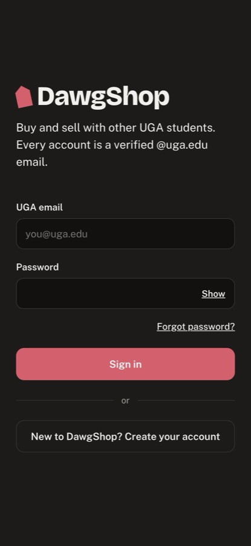

# DawgShop

**A marketplace for UGA students only.** Sign in with your @uga.edu email, then buy and sell with other verified students, including move-out stuff listed now for move-in later.

**Try it:** [dawg-shop-rak3.vercel.app](https://dawg-shop-rak3.vercel.app) (needs a @uga.edu email)
**Watch:** _demo video link coming soon_

Final project for ENTR 5000 (AI in Entrepreneurship), Fall 2026, by Conner Graham.



---

## The opportunity

Every semester, thousands of UGA students need to get rid of things fast or need to find them cheap: mini fridges, desks, futons, textbooks, lamps, game-day tickets. Today that happens in the UGA "Free & For Sale" Facebook group, class GroupMes, Facebook Marketplace and word of mouth.

None of those were built for students:

- **You don't know who you're dealing with.** Anyone can post in a Facebook group or on Marketplace. Scams and no-shows are common.
- **The timing is wrong.** Seniors moving out in May have the stuff freshmen need in August, but nothing connects them across the summer, so a lot of it ends up on the curb.
- **Location is a map radius, not a dorm.** Students think in terms of "Creswell" or "The Mark", not miles.
- **Posts get buried.** A GroupMe post is gone after an hour of messages.

DawgShop is for UGA students who want to buy and sell with people they can trust, close to where they live.

## The work

DawgShop is a working web app, built mobile-first so it feels like a phone app, and deployed live on Vercel.

**What you can do today:**

1. **Sign up with a UGA email only.** You enter your @uga.edu address, get a one-time code by email, then set a name, a password and an optional pickup spot. Any other email domain is blocked in the browser, again on the server, and a third time by a database rule, so a non-UGA account can't be created even by going around the app.
2. **Sell something in under a minute.** Add up to 5 photos (resized on your phone before upload), a title, a category, condition, price and a pickup spot.
3. **List now, hand off later.** The **move-in** feature lets a seller set an "available from" date. A senior can list a couch in May for a freshman arriving in August, and the Move-in tab groups these listings by month.
4. **Browse and filter by campus spot.** A two-column feed of everything for sale, newest first, with keyword search (course numbers work for textbooks), category chips and filters for pickup spot, maximum price and sort order. It updates live as listings are posted or sold.
5. **Manage your listings.** Edit, mark sold, unlist, relist or delete. Sold items disappear from everyone else's feed right away.

**How it's built:** Next.js 16 (React) on Vercel, with Supabase for sign-in, the Postgres database and photo storage. Privacy rules live in the database: students can see each other's name and pickup spot but never another student's email, and only a seller can change their own listings. Photos sit in private storage and are shown through links that expire after an hour.

**How I built it:** I'm not a professional developer. I built DawgShop with Claude Code as my engineering partner. I set up specialized AI agents for the project, one to build and test the app and one to manage GitHub issues and commits, and I tracked every feature as a GitHub issue with goals, open questions and progress notes. The project went from a clickable HTML mockup (October 15) to real sign-in (October 20–27), then to the full marketplace (October 29), then to a live deployment (November 6).

## The learning

**Real users break your assumptions in ways you can't predict.** My first sign-in design emailed students a "magic link", the standard approach. It failed for every UGA address. UGA mail runs on Microsoft 365, and its Safe Links scanner opens every link in incoming mail to check it for threats, which used up the one-time link before the student ever clicked it. I confirmed this in the authentication logs and switched to a typed one-time code, which a scanner can't "use". I would never have found this without testing with a real @uga.edu inbox.

**Then convenience won.** Making students enter a fresh emailed code on every sign-in was secure but annoying, so I kept the code for creating an account and resetting a password, and added a normal password for everyday sign-in.

**Trust is the product.** The @uga.edu restriction isn't a sign-up detail; it's the whole reason to use DawgShop instead of Facebook. That's why I enforced it in three separate places rather than one.

**Scope is a decision, not a failure.** I planned messaging, offers and AI-written listings from a photo. I chose to finish a complete, trustworthy loop of signing up, selling, browsing and managing listings, and to deploy it, before adding more. A smaller app that really works beats a bigger one that half works.

**AI changes who can build.** Using AI agents, one non-engineer built and shipped a real, secure, full-stack app in about six weeks. The bottleneck moved from writing code to deciding what to build and checking that it actually works.

## The next step

1. **Messaging and offers.** Today buyers and sellers arrange meetups outside the app. Next is in-app chat tied to each listing, with a Make Offer button.
2. **AI listing drafts.** Snap a photo, and AI drafts the title, category, description and a suggested price.
3. **Solve the empty-marketplace problem.** Launch in one dorm or club first, seed it with my own and friends' listings, and time the launch to December and May move-outs when students most need to sell fast.
4. **A business model.** Options I'm weighing: featured listings, ads from Athens businesses that want to reach students (movers, storage, furniture), and summer storage for move-out items. Any of these has to stay small enough that students still trust the app more than the free Facebook group.

---

## Run it yourself

Requirements: Node.js 20+ and a free [Supabase](https://supabase.com) project.

```bash
npm install
cp .env.local.example .env.local   # add your Supabase URL and anon key
npm run dev                        # http://localhost:3000
```

Database setup (tables, security rules and email templates) is in [supabase/README.md](supabase/README.md). Feature planning and progress notes are in the [GitHub issues](https://github.com/conner1520-cmyk/DawgShop/issues).

**Final ENTR 5000 submission:** tagged [`entr5000-final`](https://github.com/conner1520-cmyk/DawgShop/releases/tag/entr5000-final).
